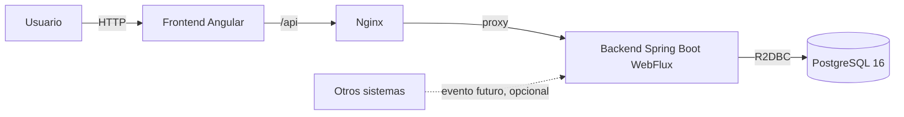
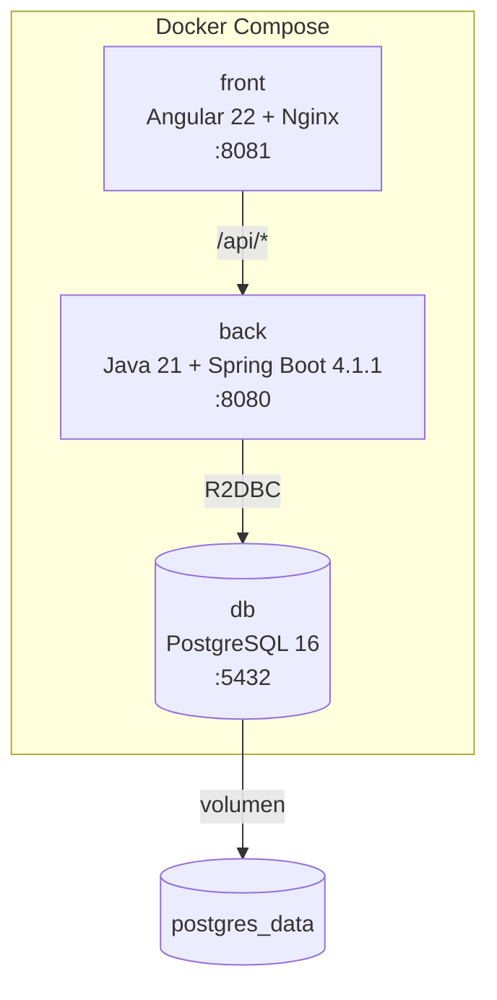
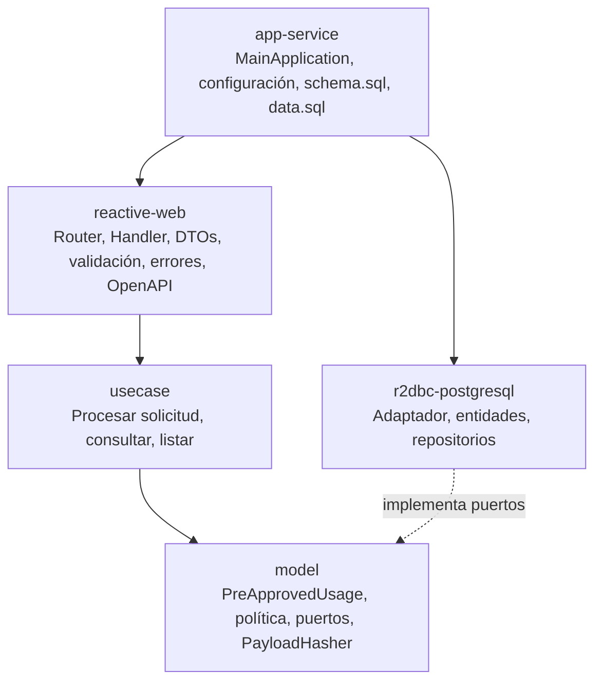
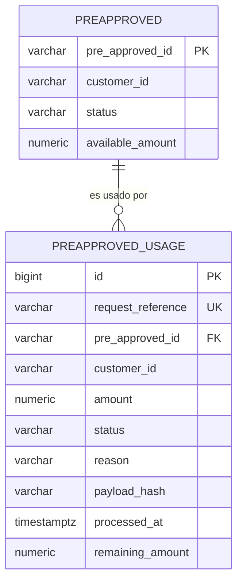
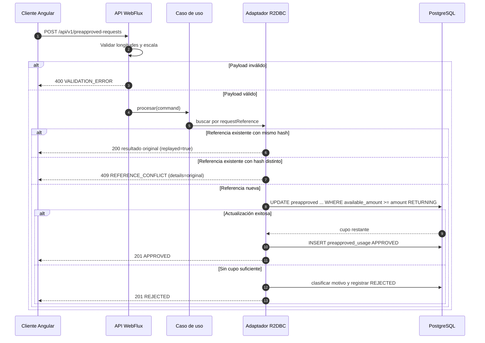
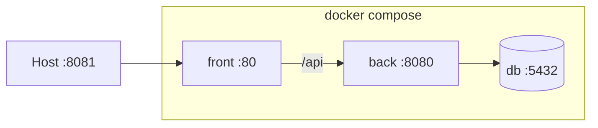

# Arquitectura — BancoIAS

## Propósito y alcance

BancoIAS procesa solicitudes de uso de cupos preaprobados, conserva el resultado de
cada solicitud y permite consultar el historial reciente. El alcance implementado es
RF01–RF07 del PDF, con backend reactivo, frontend Angular y PostgreSQL. RabbitMQ y
Flyway quedan como mejoras opcionales.

## Vista de contexto

## Contenedores

El frontend se construye en una etapa Node y se sirve como estático desde Nginx.
Nginx hace proxy de `/api` hacia `back:8080`, por lo que el navegador no necesita
CORS en el despliegue por Compose. En desarrollo, `ng serve` usa
`proxy.conf.json` con el mismo destino.

## Capas del backend

Reglas:

- `model` no depende de Spring ni de R2DBC.
- `usecase` solo conoce puertos del dominio.
- `reactive-web` traduce HTTP a comandos y comandos a respuestas.
- `r2dbc-postgresql` implementa los puertos con SQL explícito y transacciones
  reactivas.
- `app-service` compone la aplicación y concentra la configuración.

## Modelo de datos

`request_reference` es único y `payload_hash` distingue un replay legítimo de un
conflicto. Los montos usan `NUMERIC(19,2)` y el cupo tiene un `CHECK` para no ser
negativo.

## Flujo de procesamiento

La actualización condicional y el `INSERT` ocurren en la misma transacción. Si dos
solicitudes compiten por la misma referencia, la restricción única decide y la
perdedora relee la fila para responder replay o conflicto.

## Despliegue

`back` espera a que `db` esté saludable y `front` espera a que `back` esté
saludable. El healthcheck del backend consulta `/actuator/health`.

## Atributos de calidad

| Atributo | Implementación | Evidencia |
|---|---|---|
| Consistencia de cupo | `UPDATE` condicional atómico + transacción | Test de concurrencia y smoke test |
| Idempotencia | `request_reference` único + hash canónico | Tests de replay/conflicto y concurrencia |
| Reactividad | WebFlux + R2DBC, sin bloqueo en el event loop | BlockHound en pruebas |
| Contrato | OpenAPI anotado + YAML estático | `documentsOpenApiContract` |
| Validación | Longitudes 80/40/40; monto 2 decimales y 17 enteros | Handler tests y smoke test |
| Operación | Compose, healthchecks, variables de entorno | `make up`, `make smoke` |
| Trazabilidad | Commits por fase, ADRs, uso de IA | `git log`, `docs/decisiones/`, `docs/uso-ia.md` |

## Decisiones relacionadas

- [ADR-001](decisiones/ADR-001-backend-unico.md)
- [ADR-002](decisiones/ADR-002-scaffold-clean-architecture.md)
- [ADR-003](decisiones/ADR-003-concurrencia-actualizacion-condicional.md)
- [ADR-004](decisiones/ADR-004-idempotencia-request-reference.md)
- [ADR-005](decisiones/ADR-005-postgresql-r2dbc.md)
- [ADR-006](decisiones/ADR-006-rabbitmq-opcional.md)
- [ADR-007](decisiones/ADR-007-validacion-payload.md)
- [ADR-008](decisiones/ADR-008-openapi-contrato.md)
